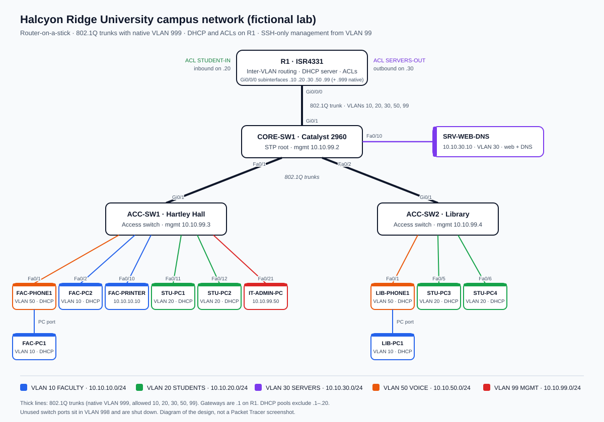
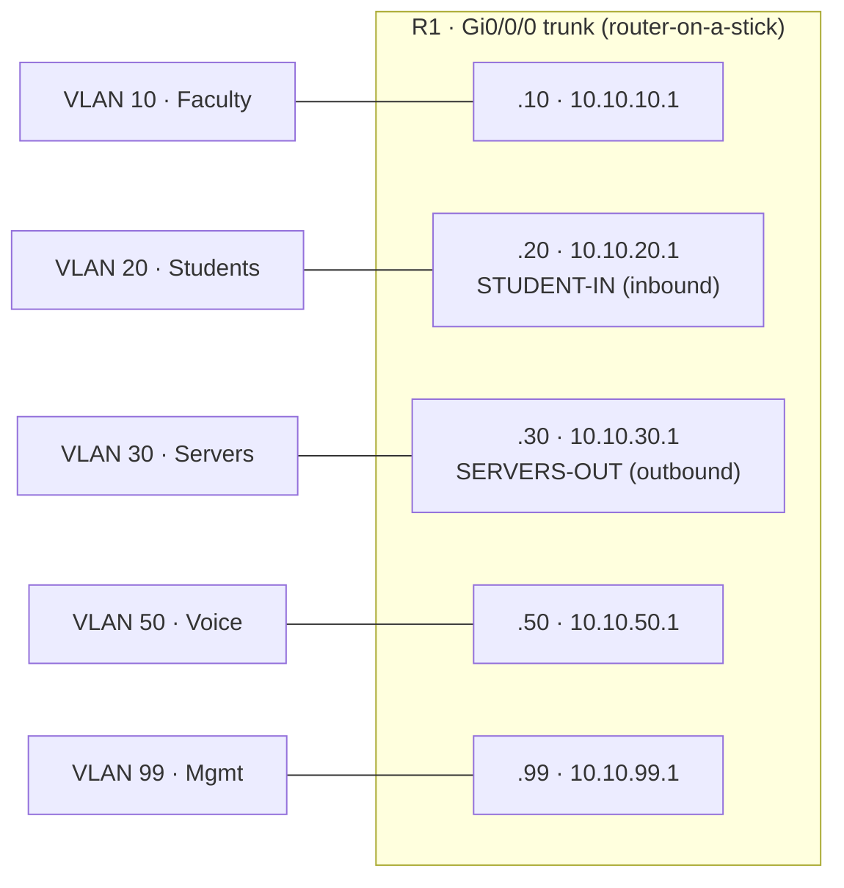

# Campus Network Lab

A campus network for a fictional university, **Halcyon Ridge University**,
designed for Cisco Packet Tracer. It has five VLANs trunked over 802.1Q,
inter-VLAN routing on a router-on-a-stick, DHCP with exclusions, a voice
VLAN for IP phones, ACLs that enforce who can reach what, and hardened,
SSH-only device management.


> **Status: in development.** The design, every device configuration, the
> test plan and the automated design checks are complete. The Packet Tracer
> build and hands-on verification are next. Results, screenshots and the
> `.pkt` file will be added as they're produced. See
> [What's verified so far](#whats-verified-so-far).



---

## What this lab demonstrates

- **VLAN design:** separate faculty, student, server, voice and management
  networks, plus a "parking" VLAN for unused ports and a dedicated native VLAN.
- **802.1Q trunking:** allowed-VLAN lists, native VLAN moved off VLAN 1, DTP
  disabled.
- **Inter-VLAN routing:** router-on-a-stick with one subinterface and gateway
  per VLAN.
- **DHCP:** three pools on the router, with exclusions protecting gateways
  and static devices.
- **Voice VLAN:** an IP phone and a PC sharing one switch port, each in its
  own VLAN.
- **ACLs:** an inbound extended ACL near the source (students) and an
  outbound one protecting the server VLAN from every network.
- **Switch security:** port security with sticky MACs, PortFast and BPDU
  Guard, unused ports shut down, VTP transparent.
- **Secure management:** SSH version 2 only, local accounts, hashed secrets,
  VTY access limited to the management VLAN.
- **Troubleshooting:** eight documented break/fix scenarios.

## Addressing and VLAN plan

| VLAN | Name | Subnet | Gateway (R1) | Addressing |
| --- | --- | --- | --- | --- |
| 10 | FACULTY | 10.10.10.0/24 | 10.10.10.1 | DHCP (.1–.20 excluded) |
| 20 | STUDENTS | 10.10.20.0/24 | 10.10.20.1 | DHCP (.1–.20 excluded) |
| 30 | SERVERS | 10.10.30.0/24 | 10.10.30.1 | Static |
| 50 | VOICE | 10.10.50.0/24 | 10.10.50.1 | DHCP (.1–.20 excluded) |
| 99 | MGMT | 10.10.99.0/24 | 10.10.99.1 | Static |
| 998 | PARKING | none | none | Unused ports, shut down |
| 999 | NATIVE | none | none | Native VLAN on trunks, no users |

| Device | Model | Management IP | Role |
| --- | --- | --- | --- |
| R1 | ISR4331 | 10.10.99.1 | Router-on-a-stick, DHCP server, ACLs |
| CORE-SW1 | 2960-24TT | 10.10.99.2 | Core switch, spanning-tree root, server port |
| ACC-SW1 | 2960-24TT | 10.10.99.3 | Hartley Hall: faculty offices, student lab, IT office |
| ACC-SW2 | 2960-24TT | 10.10.99.4 | Library: staff desks, public student computers |
| SRV-WEB-DNS | Server | 10.10.30.10 | Campus website (`www.hru.test`) and DNS |

Static hosts: FAC-PRINTER `10.10.10.10`, IT-ADMIN-PC `10.10.99.50`. The
full design, including every port and every test case, is in
[`design/lab-plan.json`](design/lab-plan.json).

## Security policy

| From → To | Faculty | Students | Servers | Voice | Mgmt |
| --- | --- | --- | --- | --- | --- |
| **Faculty** | ✅ | Ping only* | Web, DNS, ping | ✅ | Reachable; devices refuse SSH |
| **Students** | ❌ | ✅ | Web, DNS, ping | ❌ | ❌ |
| **Voice** | ✅ | Ping only* | Web, DNS, ping | ✅ | Reachable; devices refuse SSH |
| **Mgmt (IT)** | ✅ | Ping only* | Full access | ✅ | ✅ SSH to all devices |

\* ACLs are stateless. STUDENT-IN lets student devices *answer* pings, so
staff can troubleshoot them, but it blocks every other reply leaving the
student VLAN toward internal networks.

How it's enforced on R1:



- **STUDENT-IN** (inbound on `.20`): DHCP, campus web/DNS and ping to the
  server are allowed. Everything else toward internal VLANs is denied.
  Students can still answer pings from faculty and IT, so those teams can
  troubleshoot their machines.
- **SERVERS-OUT** (outbound on `.30`): any VLAN may use the services the
  server offers (HTTP, HTTPS, DNS) and ping it; only the management VLAN
  gets full access. An explicit final `deny ip any any` counts drops.
- **access-list 10** on every device's VTY lines: SSH is accepted only from
  `10.10.99.0/24`.

## How to build and test it

1. **Build:** [`docs/BUILD-GUIDE.md`](docs/BUILD-GUIDE.md). Place devices,
   cable, paste the configs from [`configs/`](configs), set up the server
   and hosts.
2. **Verify:** [`docs/VERIFICATION.md`](docs/VERIFICATION.md). Device `show`
   commands plus 32 end-to-end tests of allowed and blocked traffic, each
   with the expected result.
3. **Troubleshoot:** [`docs/TROUBLESHOOTING.md`](docs/TROUBLESHOOTING.md).
   Eight break/fix scenarios: native VLAN mismatch, missing trunk VLAN, ACL
   that blocks DHCP, port-security violation, and more.
4. **Explain it:** [`docs/INTERVIEW-PREP.md`](docs/INTERVIEW-PREP.md). The
   questions this lab prepares you to answer, with answers.

## What's verified so far

| Item | Status | How |
| --- | --- | --- |
| Addressing plan (no overlaps, gateways, unique static IPs) | ✅ Checked automatically | `pytest`, every push |
| VLANs, trunks, port roles, port security and PortFast match the design | ✅ Checked automatically | `pytest` reads the config files |
| Router subinterfaces, DHCP pools and exclusions match the design | ✅ Checked automatically | `pytest` |
| ACL logic: 32 allowed/blocked traffic cases, every ACL line exercised | ✅ Checked automatically | `pytest` runs packets through R1's ACLs as written |
| SSH-only management restricted to VLAN 99 on all four devices | ✅ Checked automatically | `pytest` |
| The checks catch real mistakes | ✅ Tested | Seven planted faults were each caught, e.g. a missing DHCP rule or a mask used in place of a wildcard |
| Configs paste cleanly into Packet Tracer | ⏳ Not yet tested | Build guide, Parts 3–4 |
| End-to-end connectivity and ACL behaviour in Packet Tracer | ⏳ Not yet tested | Verification checklist |
| IP phones receive voice-VLAN addresses | ⏳ Not yet tested | Verification P29 |
| Phone call registration (CME) | ➖ Out of scope | Not part of this design |

**What the automated checks are, and aren't.** They parse the text of the
configs and test the design rules and ACL logic: the same thinking a
reviewer applies when reading a config. They don't run Cisco IOS, so they
can't catch a command that a particular Packet Tracer version rejects. That
is exactly what the hands-on verification is for.

### Run the checks yourself

Requires Python 3.11 or newer.

```powershell
python -m venv .venv
.\.venv\Scripts\python.exe -m pip install -r requirements-dev.txt
.\.venv\Scripts\python.exe -m pytest
```

On macOS or Linux, use `.venv/bin/python` instead. The same checks run on
GitHub Actions for every push (`.github/workflows/design-checks.yml`).

## Design decisions

- **Router-on-a-stick instead of a Layer 3 switch.** It's simple and shows
  802.1Q tagging end to end. The trade-off is one trunk carrying all
  inter-VLAN traffic, which is a bottleneck and a single point of failure. A
  production campus would route on Layer 3 switches (SVIs) with a redundant
  gateway (HSRP).
- **Native VLAN 999 and a parking VLAN.** No user traffic travels untagged,
  and unused ports can't land anyone in a live VLAN.
- **VTP transparent.** Each switch owns its VLAN list, so a misconfigured
  switch can't erase the others' VLANs.
- **ACL placement.** STUDENT-IN sits close to the source (best practice for
  extended ACLs). SERVERS-OUT sits next to the servers on purpose: one list
  protects them from every VLAN.
- **DHCP on the router.** Fine at this size. With a dedicated DHCP server,
  each gateway would use `ip helper-address`.

## Possible next steps

- Move routing to a Layer 3 core switch, and add a second core with HSRP.
- Add an internet edge with NAT/PAT, and a default route.
- Register the IP phones with Cisco CME, and add QoS for voice.
- Centralize logs and time with syslog and NTP; replace local accounts with
  AAA (TACACS+/RADIUS).

## Screenshots

Real Packet Tracer screenshots will be added after the lab is built and
verified. The capture list is in [`screenshots/README.md`](screenshots/README.md).

## Repository layout

```
configs/          Paste-ready configs for R1, CORE-SW1, ACC-SW1, ACC-SW2
design/           lab-plan.json: VLANs, addressing, ports, links, test cases
docs/             Build guide, verification, troubleshooting, interview prep, diagram
labcheck/         Config parser, ACL evaluator and network model used by the checks
tests/            The automated design checks (pytest)
evidence/         Real "show" outputs and test results (added after the build)
screenshots/      Real Packet Tracer screenshots (added after the build)
packet-tracer/    The saved .pkt file (added after the build)
```

## Credits and license

Created by Nathanael Haig and Tracy Tran.

[MIT](LICENSE). Halcyon Ridge University and every name, address and
device in this lab are fictional. The configs contain lab-only placeholder
passwords; never reuse them on real equipment.
